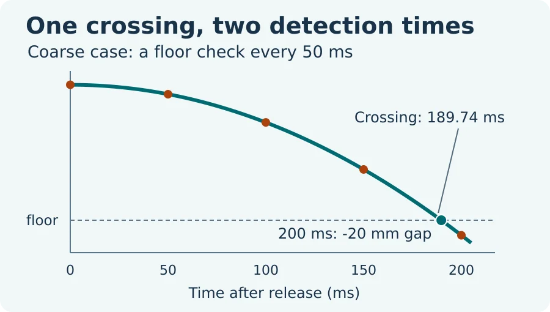

# Robot Contact Simulation: A First Impact in Python

A part falls toward a rigid floor. Compare the impact found by solving for zero clearance with the impact found by checking the floor only at clock ticks. Both methods use the same exact free flight before contact, so their difference isolates late detection.

Full lesson: [Robot Contact Simulation in Python](https://wifarobotics.com/learn/robot-contact-simulation/).

## Start with no setup

1. Install [Python 3.11 or newer](https://www.python.org/downloads/). Open a terminal and run `python3 --version`. On Windows use `py -3` instead of `python3` throughout.
2. On this repository page choose **Code**, then **Download ZIP**, or use `git clone https://github.com/williamfarokhzad/wifa-robot-contact-simulation.git`.
3. Extract the ZIP and open a terminal in the folder containing `contact.py`. No dependencies, account, robot or simulator installation is needed.
4. Run:

```sh
python3 contact.py examples/coarse.json
python3 contact.py examples/fine.json
python3 contact.py examples/exact-tick.json
python3 contact.py examples/upward.json
python3 -m unittest discover -s tests -v
```

Expected results (rounded):

| Input | Exact event time | Sampled time | Sampled gap before clamp | Exact / sampled apex |
| --- | ---: | ---: | ---: | ---: |
| coarse | 189.737 ms | 200.000 ms | −20.000 mm | 45.000 / 50.000 mm |
| fine | 189.737 ms | 190.000 ms | −0.500 mm | 45.000 / 45.125 mm |
| exact-tick | 200.000 ms | 200.000 ms | 0 mm | 0 / 0 mm |
| upward | 300.000 ms | 300.000 ms | 0 mm | 200 / 200 mm |

The JSON uses metres, seconds, kilograms and newton seconds. Positive velocity points upward; enter a positive gravity magnitude. A negative gap reports overshoot of the hypothetical free flight before the clamp. To try another scenario, copy an example and edit one value. Set restitution to zero and check that the rebound is zero while the impact impulse is still positive.



## Where to look

* `contact.py`: compare both methods, validate the input and print a JSON report.
* `examples/`: four self-contained inputs.
* `tests/`: independent energy, exact grid, high precision root and CLI checks.
* `diagrams/`: source SVGs and WebPs. `python3 diagrams/render.py` regenerates the SVGs from the example data. Regenerating the optional WebPs is separate from running the lab: with ImageMagick 7, for example, use `magick diagrams/contact-crossing.svg -resize 900x -quality 85 diagrams/contact-crossing.webp`, substituting the other diagram name or 600 px output as needed. Encoders can produce different bytes.

## Troubleshooting

If Python cannot find `contact.py`, open a terminal in the extracted folder and list its files. If the CLI exits 2, read the named field or missing path in the error. Restitution is a number from 0 to 1, not a percentage. Convert millimetres to metres before editing a scenario. If both methods agree, choose a step that does not divide the event time; an aligned grid can hide the error.

This compares one impact of a point mass in one dimension. It does not compute contact force, repeated bounces, friction, material deformation, actuator response or loads on a physical robot. For context, see the [Box2D simulation manual](https://box2d.org/documentation/md_simulation.html) and [MuJoCo computation documentation](https://mujoco.readthedocs.io/en/stable/computation/index.html).
